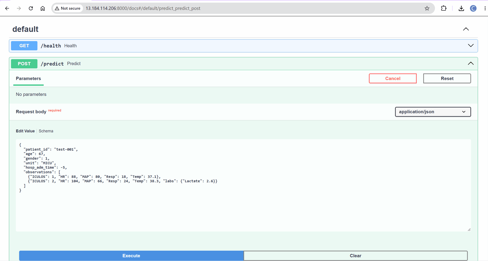
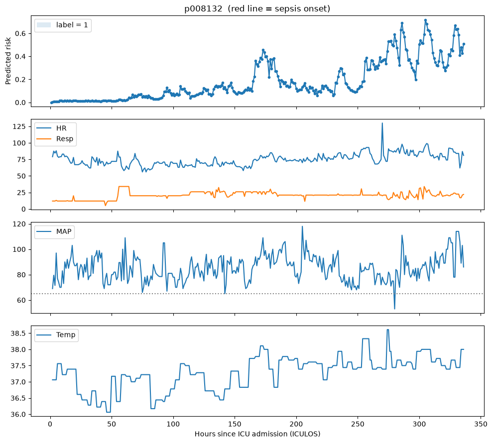
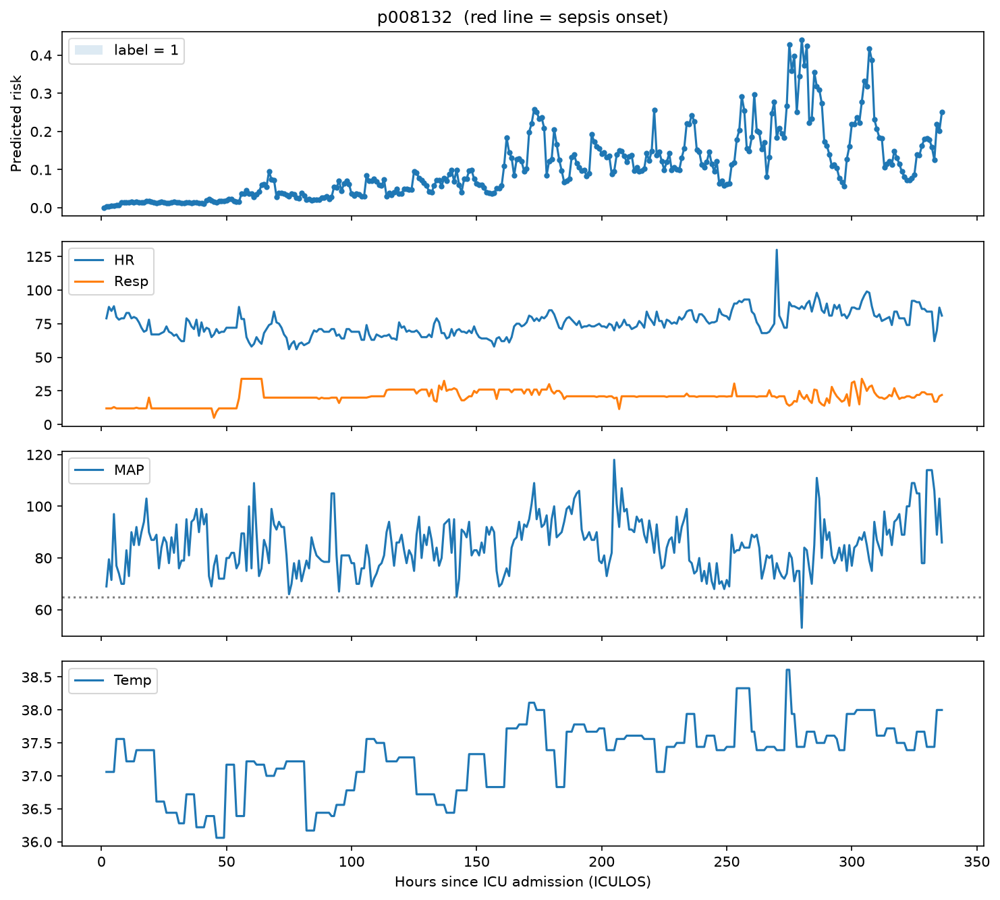
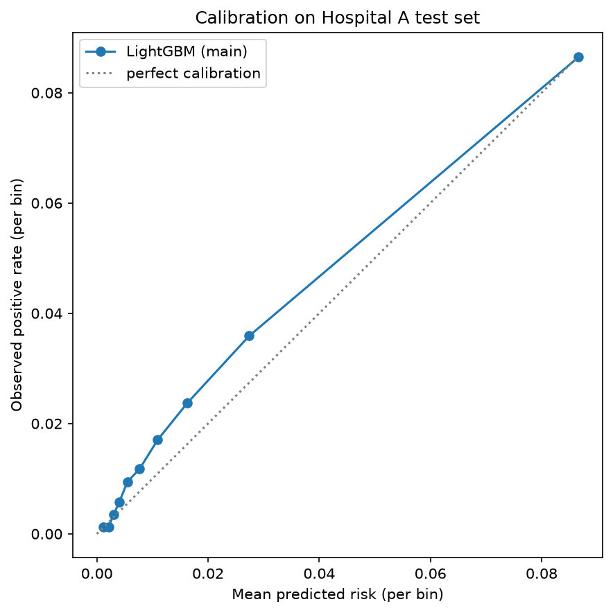
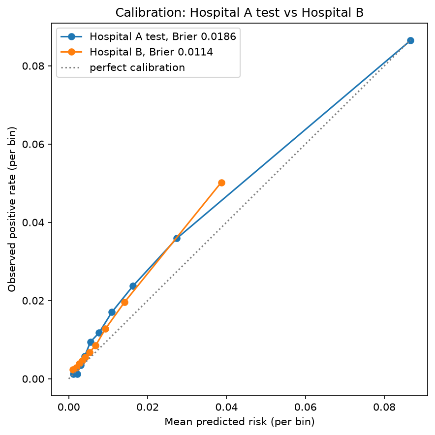
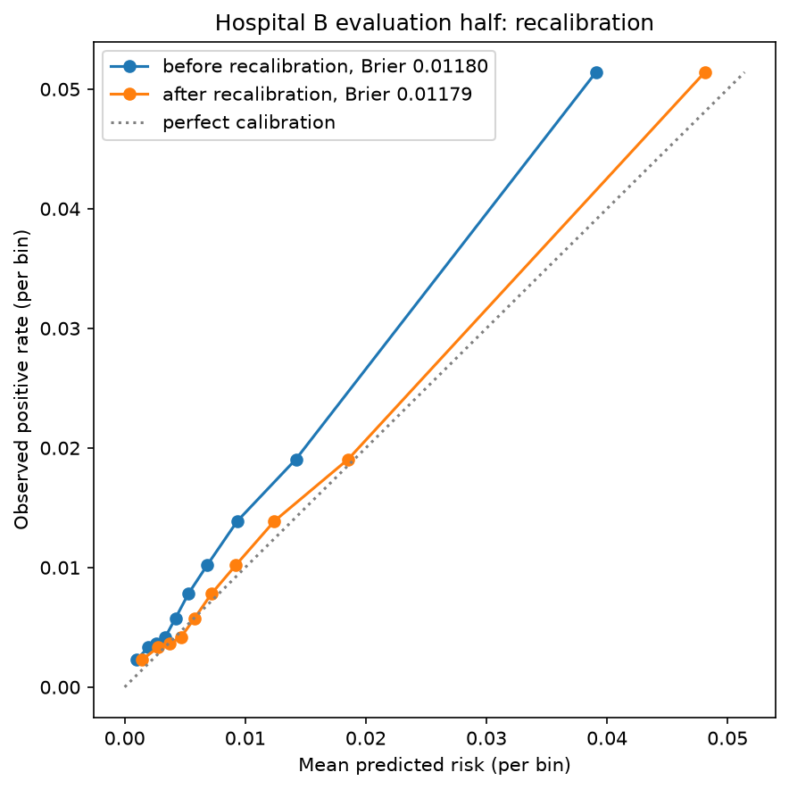
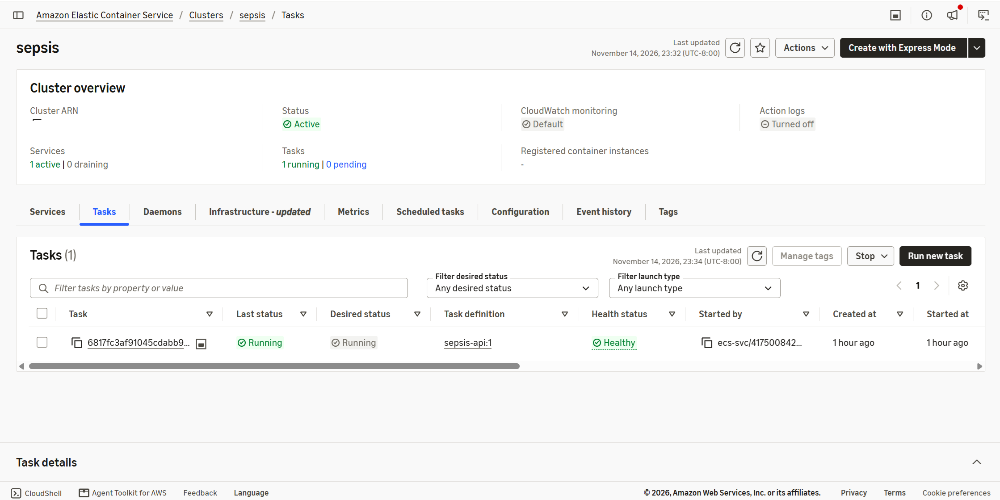

# Sepsis Early-Warning System


Predicting sepsis hours before onset from hourly ICU data, with external validation on a second hospital, served as a containerized API that accepts plain JSON or FHIR R4.



## Highlights
- **40,336 ICU patients** from two hospitals; reproducible pipeline: DuckDB SQL cohort and 148 point-in-time features, LightGBM, MLflow tracking, automated leakage tests.
- **Held-out test set (Hospital A):** AUROC 0.805 (95% CI 0.782–0.827). At the chosen threshold, the model warns **49% of septic patients a median 8 hours before onset**, with about 8 alerts per true early warning.
- **External validation at a second hospital:** AUROC 0.805 → 0.768; traced the loss of calibration to one site-specific measurement habit (FiO2 recording) with drift analysis and SHAP; local recalibration restored early-warning sensitivity.
- **Found and removed two shortcuts** created by how the dataset was assembled: ICU length of stay (would inflate validation AUPRC by ~29%) and a hidden proxy for it in "hours since last measured" features, found through SHAP error analysis.
- **Honest evaluation:** pre-onset performance reported separately from post-onset; subgroup results checked at both hospitals; early-stay limitation quantified.
- **Deployed:** FastAPI service with input validation, per-prediction SHAP explanations and a FHIR R4 endpoint (LOINC codes, UCUM unit checks); Docker image; GitHub Actions CI; run on AWS ECS Fargate. Serving reuses the training feature SQL, and a test confirms served predictions equal the training pipeline's. The same image gave identical predictions locally, in CI and on AWS.

## Data
PhysioNet/Computing in Cardiology Challenge 2019 (v1.0.0): hourly ICU vitals, labs and demographics for 40,336 patients from two hospital systems (A: 20,336; B: 20,000). SepsisLabel follows Sepsis-3 and turns on 6 hours before onset.

## Cohort, splits and labels

**Cohort**
- Excluded septic patients labeled from their first recorded hour (n = 426; A: 203, B: 223). Their onset falls within ~6 h of the start of the record or before ICU admission, so it cannot be determined, and there is nothing to predict in advance. This follows the practice of excluding early-onset cases in prior work (e.g. DeepAISE; Moor et al., 2021), with the threshold set by this dataset's labeling.
- The model targets sepsis that develops during the ICU stay. Results are not directly comparable to the 2019 challenge leaderboard, which evaluated all patients.
- Cohort: 39,910 patients included (A: 20,133; B: 19,777).

**Splits**
| Split | Patients | Septic (rate) | Hours | Positive hours |
|---|---|---|---|---|
| Train (A) | 14,092 | 1,110 (7.88%) | 550,591 | 1.95% |
| Validation (A) | 3,020 | 238 (7.88%) | 119,450 | 1.93% |
| Test (A) | 3,021 | 239 (7.91%) | 118,406 | 1.96% |
| External (B) | 19,777 | 919 (4.65%) | 760,117 | 1.17% |

- Hospital A: patient-level 70/15/15 split, stratified by sepsis status, using a reproducible md5-based shuffle.
- Hospital B: held out entirely as an external test set; not used for any modeling decisions.

**Labels**
- SepsisLabel used as provided (already shifted 6 h before onset); no additional shift.

## Known data artifacts
- **Truncation:** septic records end 1–3 h after onset (~99% end 8–10 rows after the first label), so total record length is leakage.
- **Length cap:** non-septic records rarely exceed 60 h (A: 6 of 18,546), while ~35% of septic records do. Rows after hour 60 are ~9× more likely to be positive at A (14.2% vs 1.5%). ICULOS is therefore excluded from the main model, and only fixed-window features are used.
- **Hospital differences:** sepsis prevalence differs (7.9% vs 4.6% after exclusion), and measurement patterns differ: blood gases are nearly absent at B, EtCO2 is never measured at A, and DBP is missing 48% of hours at A vs 14% at B. Their effect on the model is analyzed under *External validation*.
- **Lab ordering** surges at onset, reflecting clinician suspicion rather than early warning; performance is therefore also evaluated on pre-onset hours.

## Features
148 features per patient-hour, computed in SQL (generated by `src/features.py`) from each patient's history up to the current hour. Backward-looking windows only, enforced by automated tests.

- **Vital signs** (HR, O2Sat, Temp, SBP, MAP, DBP, Resp): 6 h mean/min/max, 24 h mean, last value, hours since measured, count measured in 6 h. **Within-patient change:** 6 h mean minus 24 h mean, to capture deterioration relative to the patient's own baseline. Window lengths (6/12/24 h) are design choices.
- **Labs** (20 retained): last value, hours since measured, number of results in 24 h, change over 24 h.
- **Clinical features:**
  - *Warning-criteria count:* number of SIRS criteria met (HR > 90, Resp > 20, Temp > 38 or < 36 °C, WBC > 12 or < 4 ×10⁹/L) (Bone et al., 1992). Used as an input feature, not a sepsis definition; Sepsis-3 considers SIRS insufficient to define sepsis (Singer et al., 2016). PaCO2 and band criteria omitted.
  - *Sustained hypotension:* hours in the last 12 with MAP < 65 mm Hg, the Sepsis-3 septic shock threshold and the recommended initial MAP target (Singer et al., 2016; Evans et al., 2021).
  - *Shock index* (HR / SBP), associated with mortality in septic shock (Jouffroy et al., 2019).
- **Measurement and ordering features:** test timing in EHRs carries predictive information, often more than test results (Agniel et al., 2018). Because ordering may reflect clinician suspicion, these features are evaluated in a with/without ablation.
- **Context:** hours of data available in the last 24 h (capped, so it cannot reveal record length); total lab results in the last 24 h.
- **Hours-since-measured features are capped at 24 h.** Uncapped, they grow with time in the ICU and act as a proxy for length of stay (see *Leak found through error analysis*). The cap gives up the distinction between "measured more than a day ago" and "measured many days ago" in exchange for removing that shortcut.
- **Excluded:** ICULOS (dataset artifact); any cumulative count since admission; EtCO2 (never measured at Hospital A); AST, Alkalinephos, Bilirubin_direct, Bilirubin_total, Fibrinogen, TroponinI (≥ 98% missing at both hospitals).
- **Missing values** are left missing for LightGBM (handled natively), preserving the "not measured" signal; logistic regression uses median imputation.

**Tests** (`tests/test_features.py`):
- *Point-in-time test:* features are recomputed with all rows after hour *t* removed; the features at hour *t* must be identical. Verified to fail when a forward-looking window is introduced.
- *Clock test:* on a 200-hour patient with labs measured only once, no hours-since feature may exceed 24 h.

## Models and results
- **Logistic regression** (median imputation, standardization) as a baseline; **LightGBM** as the main model (learning rate 0.03, 63 leaves, min 200 samples per leaf, row/feature subsampling, early stopping on validation AUPRC).
- Trained on Hospital A train; validation used for early stopping, model comparison and threshold selection; test and Hospital B untouched until final evaluation.
- Unweighted training; every run tracked in MLflow (parameters, metrics, model, feature list).

**Validation results and ablations (Hospital A)**
| Model | AUROC | AUPRC |
|---|---|---|
| Logistic regression | 0.784 | 0.070 |
| LightGBM (main) | 0.809 | 0.083 |
| LightGBM + ICULOS | 0.833 | 0.106 |
| LightGBM − ordering features | 0.799 | 0.076 |
| LightGBM + class weighting | 0.809 | 0.086 |
| Random (positive rate) | 0.5 | 0.019 |
- ICULOS would inflate AUPRC by ~29% (0.083 → 0.106) via the record-length artifact; excluded.
- Ordering features add ~8% AUPRC (down from ~14% before the hours-since fix; part of their apparent value was the hidden clock).
- Class weighting gave no meaningful gain in discrimination and badly miscalibrated risk (mean predicted 0.228 vs observed 0.019; Brier 0.101 vs 0.019), consistent with van den Goorbergh et al. (2022) and Carriero et al. (2024). Training is unweighted.

**Validation decisions** (all made before touching the test set)
- **Early warning is harder than detection at onset:** pre-onset AUPRC 0.046 (95% CI 0.038–0.057) vs 0.083 over all hours.
- **Ordering features help mostly at/after onset:** +0.007 AUPRC over all hours but only +0.002 before onset (CIs overlap), i.e. largely echoing clinician suspicion. Kept in the main model; both models are compared at Hospital B.
- **Threshold 0.05,** chosen by a rule fixed in advance: early-warn about half of septic patients.

## Leak found through error analysis
SHAP on a false alarm (p008132, non-septic, 336 h stay) showed risk climbing steadily over two weeks, driven by "hours since last measured" values of 234–252 h. These features acted as a proxy for length of stay, which is confounded with the label in this dataset. Capping them at 24 h removed the proxy: main-model AUPRC fell from 0.089 to 0.083 (the honest estimate), this patient's peak risk fell from 0.72 to 0.44 and now tracks the fever that developed in week two, and a test prevents regressions.

| Before | After |
|---|---|
|  |  |

## Alert simulation
Design choices, not challenge rules: an alert fires when risk ≥ threshold, then the patient's alerts are silenced for 6 h (following COMPOSER's alarm silencing). A septic patient counts as warned early if an alert fires within the 12 h before onset (the earliest point credited by the 2019 challenge utility score); lead time is the time from the first such alert to onset. Alerts for septic patients from 12 h before onset onward count as true alerts; all others, including alerts days before onset, count as false alarms. Alert burden is reported per 100 patient-days.

## Test-set results (Hospital A, evaluated once)
Final model: LightGBM (MLflow run `8eb22f64`). Threshold 0.05 chosen on validation. 95% CIs from 500 patient-level bootstrap resamples. 3,021 patients, 239 septic.

**Discrimination**
| Scope | AUROC | AUPRC | Random AUPRC |
|---|---|---|---|
| All hours | 0.805 (0.782–0.827) | 0.091 (0.075–0.112) | 0.020 |
| Pre-onset hours (early warning) | 0.793 (0.767–0.816) | 0.054 (0.044–0.070) | 0.012 |

All test metrics are within noise of validation (e.g. AUROC 0.809, early sensitivity 49.6%), indicating that model and threshold selection on validation did not overfit.

**Alerting**
| Threshold | Septic patients warned early | Median lead time | Alerts per 100 patient-days | Alert PPV | Non-septic patients alerted |
|---|---|---|---|---|---|
| 0.03 | 152 / 239 (64%) | 8 h | 70 | 9.9% | 28% |
| **0.05** | **116 / 239 (49%)** | **8 h** | **39** | **13.2%** | **16%** |
| 0.10 | 68 / 239 (28%) | 7.5 h | 15 | 17.4% | 6% |

About 8 alerts per true early warning: roughly 4× better than chance and in the typical range for sepsis alerting tools (e.g. the Epic Sepsis Model's externally measured PPV of 12%; Wong et al., 2021; different setting, not a direct comparison).

**Calibration:** mean predicted risk 1.65% vs observed 1.96% (Brier 0.019); mild underestimation in mid-range risk.



**Subgroups** (threshold 0.05)
| Group | Septic | AUROC (95% CI) | Early sensitivity | Non-septic alerted |
|---|---|---|---|---|
| Age < 50 | 51 | 0.833 (0.792–0.877) | 55% | 15% |
| Age 50–64 | 70 | 0.788 (0.742–0.835) | 49% | 15% |
| Age 65–79 | 80 | 0.812 (0.772–0.853) | 50% | 15% |
| Age 80+ | 38 | 0.788 (0.737–0.834) | 37% | 20% |
| Female | 114 | 0.784 (0.755–0.814) | 41% | 16% |
| Male | 125 | 0.825 (0.794–0.859) | 55% | 16% |

Lower early sensitivity for female patients (41% vs 55%) and for patients aged 80+ (37%, with more false alarms) were flagged as potential disparities; neither gap replicated at Hospital B (see *External validation*).

**Limitation: early-stay sepsis**
| Onset timing | Septic patients | Warned early | Median lead |
|---|---|---|---|
| After first 24 h of record | 158 | 60% | 8 h |
| Within first 24 h | 81 | 27% | 7.5 h |

About a third of septic patients develop sepsis within their first day, and the model warns only about a quarter of them early, consistent with SHAP showing that limited history strongly lowers predicted risk.

## External validation (Hospital B)
The frozen model and threshold were applied to Hospital B (19,777 patients, 919 septic), which played no part in development.

**Discrimination transfers, with a moderate drop**
| | AUROC | AUPRC | Random AUPRC |
|---|---|---|---|
| A test, all hours | 0.805 (0.782–0.830) | 0.091 | 0.020 |
| B, all hours | 0.768 (0.753–0.781) | 0.052 | 0.012 |
| A test, pre-onset | 0.793 | 0.054 | 0.012 |
| B, pre-onset | 0.749 (0.734–0.762) | 0.028 | 0.007 |

AUPRC stays ~4× above chance at both hospitals. The model without ordering features performs the same at B (AUROC 0.771, AUPRC 0.048).

**The threshold and calibration do not transfer.** At threshold 0.05, B gets a third as many alerts as A (13 vs 39 per 100 patient-days) and half the early warnings (25% vs 49% of septic patients). The model underestimates risk at B (mean predicted 0.87% vs observed 1.17%).



**Why: measurement habits, not patients.** The largest feature shifts are in how often tests are recorded (PTT missing 33% → 78%; FiO2 missing 42% → 71%) and in pre-ICU workflow (hospital time before ICU: median 2.6 → 9.0 h), while physiological values are similar. Decomposing the score shift with SHAP: B's mean log-odds are 0.377 lower, ~82% of it from FiO2 recording features. At A, a recent FiO2 measurement (oxygen support) strongly raised risk; at B it is often absent.

**Local adaptation** (fit on a random half of B's patients, evaluated on the other half)
| On B evaluation half | A's threshold, original scores | Recalibrated, local threshold 0.03 |
|---|---|---|
| Septic patients warned early | 25% | 52% |
| Median lead time | 5 h | 7 h |
| Alerts per 100 patient-days | 13 | 42 |
| Alert PPV | 11.0% | 7.7% |

Logistic recalibration (slope 0.96, intercept 0.10) fixes the scale (mean predicted 0.88% → 1.14% vs observed 1.21%) without changing ranking (AUROC 0.766). Re-choosing the threshold with the same rule restores early warning to A's level, at about 13 alerts per true early warning instead of ~8. Recovering precision would require retraining with B-like data or features less dependent on site-specific measurement habits.



**Subgroups and early-stay at B**
- The sex gap seen on A's test set did not replicate at B (early sensitivity: female 26%, male 24%; AUROC 0.779 vs 0.759), and the age pattern was inconsistent across hospitals: no consistent subgroup disparity, with A's gaps most likely chance.
- The early-stay limitation replicated: septic patients with onset within the first 24 h were warned early at less than half the rate of later onset (B: 12% vs 30%; A: 27% vs 60%).

## Serving API
A FastAPI service (`src/api.py`) scores a patient's latest hour from their hourly history and explains the score. Interactive docs are at `/docs`.

| Endpoint | Input | Returns |
|---|---|---|
| `GET /health` | – | Status and the model's MLflow run ID |
| `POST /predict` | JSON: demographics + hourly observations | Risk, alert flag, top 5 reasons |
| `POST /predict/fhir` | FHIR R4 Bundle (one Patient + Observations) | Same, plus the number of ignored observations |

**Example request** (`POST /predict`):
```json
{
  "patient_id": "test-001",
  "age": 67,
  "gender": 1,
  "unit": "MICU",
  "hosp_adm_time": -5,
  "observations": [
    {"ICULOS": 1, "HR": 88, "MAP": 80, "Resp": 18, "Temp": 37.1},
    {"ICULOS": 2, "HR": 104, "MAP": 66, "Resp": 24, "Temp": 38.3, "labs": {"Lactate": 2.6}}
  ]
}
```

**Response** (abridged):
```json
{
  "patient_id": "test-001",
  "risk": 0.0179,
  "alert": false,
  "threshold": 0.05,
  "hour": 2,
  "top_reasons": [
    {"feature": "hours_available24", "value": 2, "contribution": -1.114},
    {"feature": "SBP_mean24", "value": null, "contribution": 0.301},
    {"feature": "warning_criteria_count", "value": 3, "contribution": 0.221}
  ],
  "model_run_id": "8eb22f64550f4aaa813a9a521a0fc3f9"
}
```
`contribution` is the feature's SHAP value in log-odds (LightGBM `pred_contrib`): positive values raise risk. Here, only 2 hours of history lowers risk most (the early-stay limitation above), while fever, tachycardia and fast breathing raise it.

**FHIR endpoint:** `examples/fhir_bundle.json` is a sample Bundle.
```
curl -X POST http://localhost:8000/predict/fhir -H "Content-Type: application/json" -d @examples/fhir_bundle.json
```
- Observations are mapped by LOINC code (e.g. 8867-4 heart rate, 8310-5 body temperature, 8478-0 mean arterial pressure, 2524-7 lactate); codes the model doesn't use are skipped and counted in `ignored_observations`.
- Units are checked against UCUM codes; a wrong unit is rejected (422), and °F is converted to °C.
- Timestamps are bucketed into ICU hours from `icu_admission` (query parameter) or the earliest observation, and averaged within each hour. Age is computed from the Patient's birth date.

**Input handling**
- Requests are validated with Pydantic: physiologically impossible values, unknown labs, duplicate hours and empty histories are rejected with 422.
- Missing vitals and labs are left missing, as in training.
- `hosp_adm_time` was never missing in training; if omitted, it is filled with the Hospital A training median (−2.59 h).
- **Training/serving consistency:** the API computes features with the same SQL generator used for training (`feature_sql`, run in an in-memory DuckDB), and `tests/test_api.py` checks that a real test patient's served risk equals the training pipeline's prediction.

## Deployment
- **Docker:** `python:3.12-slim` base, API-only pinned dependencies (`requirements-api.txt`), runs as a non-root user, with a container health check.
- **CI** (GitHub Actions, `.github/workflows/ci.yml`): on every push, runs the test suite, then builds the image, starts it and checks `/health`. The training/serving test is skipped in CI because the data cannot be redistributed.
- **AWS:** the image was pushed to ECR (scanned on push, immutable tags) and run on ECS Fargate (0.5 vCPU, 1 GB) with logs in CloudWatch and ECS health checks. The same requests returned identical predictions locally and on AWS. The service was recorded (demo above) and then shut down to avoid cost; `deploy/` contains the task definition to redeploy it.



**Deliberate demo-scale choices:** no load balancer (about $16/month even when idle), and the port is open only to a single IP instead of the internet. A production deployment would add an HTTPS load balancer, authentication, autoscaling and prediction logging.

## Model card
Following the structure of Mitchell et al. (2019).

- **Model:** LightGBM binary classifier, MLflow run `8eb22f64550f4aaa813a9a521a0fc3f9`; 148 features; alert threshold 0.05.
- **Intended use:** a research and portfolio prototype demonstrating an end-to-end clinical ML workflow: hourly risk of sepsis (Sepsis-3, label shifted 6 h before onset) for adult ICU patients, with explanations. **Not for clinical use**: not prospectively validated, not regulatory-cleared, and not evaluated against clinician judgment.
- **Training data:** Hospital A (14,092 patients) from the PhysioNet 2019 Challenge; validation (3,020) for early stopping and threshold selection.
- **Evaluation data:** Hospital A held-out test (3,021 patients) and Hospital B external (19,777 patients). See the results above.
- **Key metrics:** AUROC 0.805 (A test), 0.768 (B). At threshold 0.05 on A: 49% of septic patients warned early (median 8 h), alert PPV 13.2%, 39 alerts per 100 patient-days.
- **Factors evaluated:** hospital, age group, sex, onset timing. No consistent subgroup disparity across hospitals; early-stay sepsis is detected much less often at both.
- **Limitations and risks:**
  - Sepsis that develops in the first 24 h is detected at less than half the rate of later onset.
  - Calibration and the threshold do not transfer between hospitals; local recalibration and threshold selection are needed before any use at a new site.
  - The model partly learns site-specific measurement habits (e.g. FiO2 recording) and clinician ordering behavior, not only patient physiology.
  - Labels are retrospective and inherit the dataset's artifacts (record truncation and length caps), which were mitigated but may not be fully removed.
  - About 7 of 8 alerts are false at A; alert fatigue would need to be evaluated with clinicians.
  - Predictions with little history or many missing inputs are less reliable, and the API does not yet flag them.

## Reproduce
1. Download the data:
   `aws s3 sync --no-sign-request s3://physionet-open/challenge-2019/1.0.0/training/ data/raw/`
2. `pip install -r requirements.txt`
3. `python -m src.load_data`
4. `python -m src.build_cohort`
5. `python -m src.features`
6. Run tests: `python -m pytest -v`
7. Train: `python -m src.train --model lgbm` (also `--model logreg`; ablations: `--with-iculos`, `--without-ordering`, `--class-weight`)
8. Score a split with a trained run: `python -m src.predict --run-name lgbm --split test` (or `--split external`)
9. View experiments: `mlflow ui --backend-store-uri sqlite:///mlflow.db`
10. Export the final model for serving: `python -m src.export_model` (writes `models/model.txt` and `models/metadata.json`)
11. Run the API locally: `uvicorn src.api:app --reload`, then open http://localhost:8000/docs
12. Or with Docker: `docker build -t sepsis-api .` then `docker run --rm -p 8000:8000 sepsis-api`

The API and its tests need only `requirements-api.txt` / `requirements-dev.txt` and the exported model in `models/`, not the data.

## Project structure
- `src/` — pipeline code (`columns.py`, `load_data.py`, `build_cohort.py`, `features.py`, `train.py`, `predict.py`, `evaluate.py`, `export_model.py`) and serving code (`api.py`, `serving.py`, `schemas.py`, `fhir.py`)
- `sql/` — cohort SQL; `sql/generated/features.sql` is the full feature query written by `src/features.py`
- `tests/` — feature-pipeline tests (point-in-time, clock), API tests (validation, training/serving consistency) and FHIR tests
- `models/` — exported LightGBM model and metadata used by the API
- `examples/` — sample FHIR Bundle
- `deploy/` — ECS Fargate task definition and role trust policy
- `notebooks/` — exploration and checks (01–04), SHAP and error analysis (05), validation decisions (06), test-set evaluation (07), external validation (08)
- `reports/figures/` — figures used in this README
- `Dockerfile`, `.github/workflows/ci.yml` — container image and CI

## Next steps
- Model for early-stay sepsis (onset within the first 24 h)
- Reduce dependence on site-specific measurement features (e.g. FiO2 recording) and retrain with multi-site data
- Return warnings when inputs are missing or imputed
- Abstention ("indeterminate") output for out-of-distribution patients
- Survival analysis (time to sepsis) as a complementary model
- Decision curve analysis
- Production deployment: HTTPS load balancer, authentication, Kubernetes with autoscaling
- Prediction logging to PostgreSQL for drift monitoring

## References
- Agniel D, Kohane IS, Weber GM. Biases in electronic health record data due to processes within the healthcare system: retrospective observational study. *BMJ*. 2018;361:k1479.
- Bone RC, Balk RA, Cerra FB, et al. Definitions for sepsis and organ failure and guidelines for the use of innovative therapies in sepsis. *Chest*. 1992;101(6):1644–1655.
- Carriero A, Luijken K, de Hond A, Moons KGM, van Calster B, van Smeden M. The harms of class imbalance corrections for machine learning based prediction models: a simulation study. arXiv:2404.19494. 2024.
- Evans L, Rhodes A, Alhazzani W, et al. Surviving Sepsis Campaign: international guidelines for management of sepsis and septic shock 2021. *Crit Care Med*. 2021;49(11):e1063–e1143.
- Jouffroy R, et al. Prehospital shock index to assess 28-day mortality for septic shock. *Am J Emerg Med*. 2019. doi:10.1016/j.ajem.2019.11.004
- Mitchell M, Wu S, Zaldivar A, et al. Model cards for model reporting. *Proceedings of the Conference on Fairness, Accountability, and Transparency (FAT\*)*. 2019:220–229.
- Moor M, et al. Predicting sepsis in multi-site, multi-national intensive care cohorts using deep learning. arXiv:2107.05230. 2021.
- Reyna MA, Josef CS, Jeter R, et al. Early prediction of sepsis from clinical data: the PhysioNet/Computing in Cardiology Challenge 2019. *Crit Care Med*. 2020;48(2):210–217.
- Shashikumar SP, et al. DeepAISE: an end-to-end development and deployment of a recurrent neural survival model for early prediction of sepsis. arXiv:1908.04759. 2019.
- Singer M, Deutschman CS, Seymour CW, et al. The Third International Consensus Definitions for Sepsis and Septic Shock (Sepsis-3). *JAMA*. 2016;315(8):801–810.
- van den Goorbergh R, van Smeden M, Timmerman D, Van Calster B. The harm of class imbalance corrections for risk prediction models: illustration and simulation using logistic regression. *J Am Med Inform Assoc*. 2022. arXiv:2202.09101.
- Wong A, Otles E, Donnelly JP, et al. External validation of a widely implemented proprietary sepsis prediction model in hospitalized patients. *JAMA Intern Med*. 2021;181(8):1065–1070.